# TagDesk

**Asset tag printing for MSPs.**

Issue, print and look up asset tags for the equipment you manage. Each tag
carries your client's name, a short permanent code (like `7KQ3M`) and a QR
code. Scanning the QR code opens the device's record for your staff, and
shows everyone else who owns the device and how to contact you.

Built for IT service providers who tag kit on behalf of their clients, but it
works just as well for a single organisation tagging its own equipment.

- **Tags with client names:** labels show the client's name, the tag code
  and "Managed by &lt;your organisation&gt;". Loan kit gets its own red tag.
- **Prints straight to a Brother label printer** on your network (the
  PT-P950NW or PT-P900W). The app checks the loaded cassette is the
  right width and colour first, then prints each label cut separately or a
  whole batch as one strip with cut lines.
- **Tape tracking:** shows roughly how much tape is left in each cassette.
- **Public scan page:** anyone who scans a tag sees the owner, the device name
  and your support contact. Staff who are signed in go straight to the record.
- **Hudu integration (optional):** link tags to Hudu assets, sync your client
  list, and write each tag's code into the asset in Hudu.
- **Microsoft sign-in (optional)** alongside local accounts, with admin and
  user roles.
- **One small container:** Python (FastAPI) and SQLite, no other services.

## Screenshots

All screenshots and examples use made-up demo data.

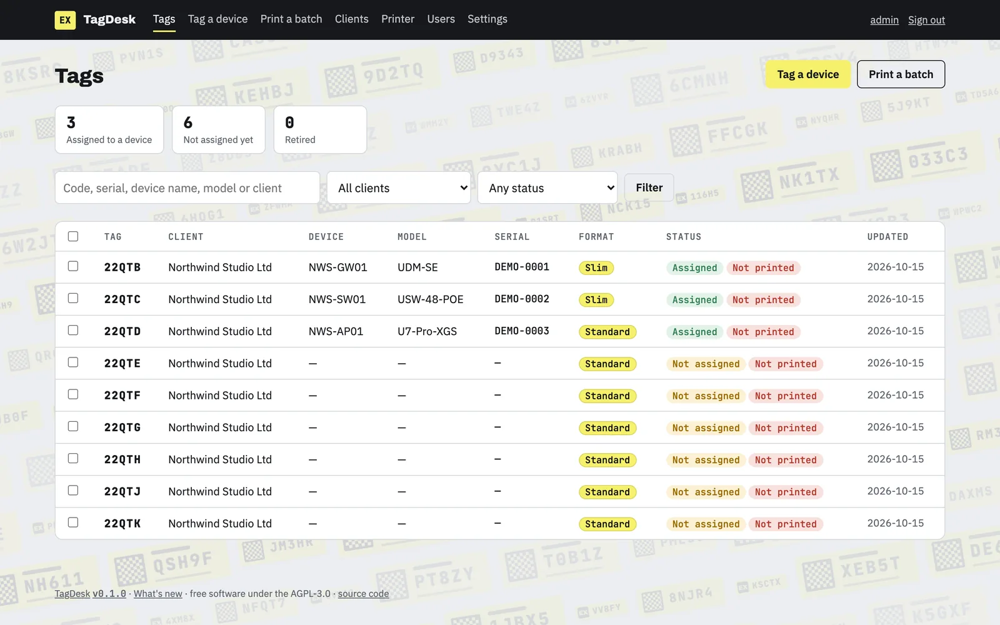

### Tags on kit

Drawn examples of real TagDesk labels. **Scan any QR code with your phone**
to see the page someone gets when they scan a tag without signing in.

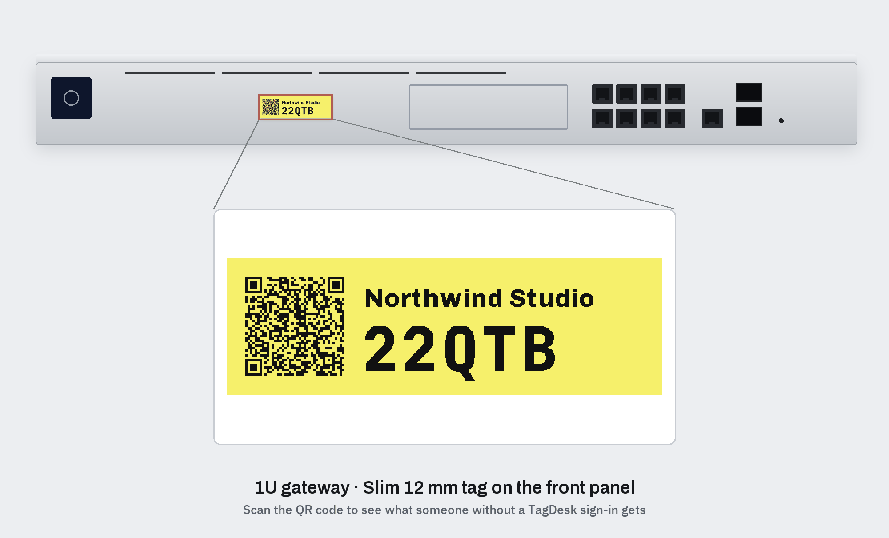

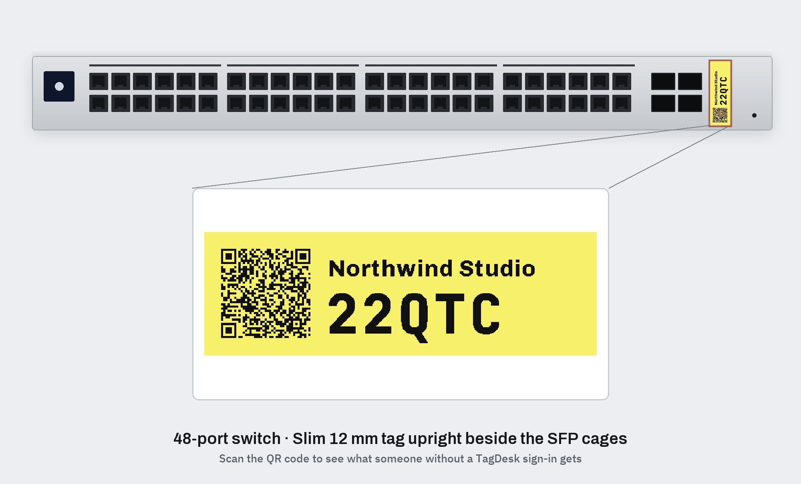

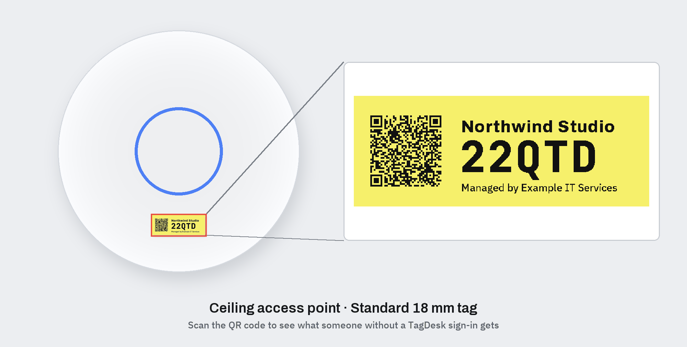

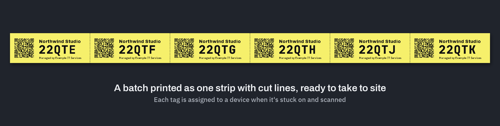

### What a scan shows

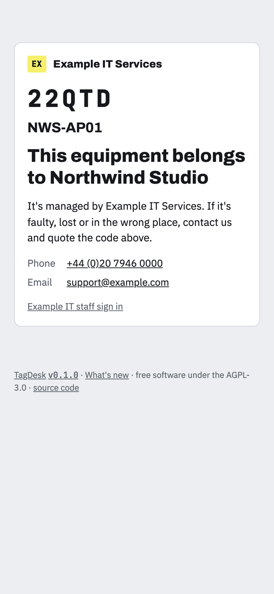

### In the app

| | |
|---|---|
| 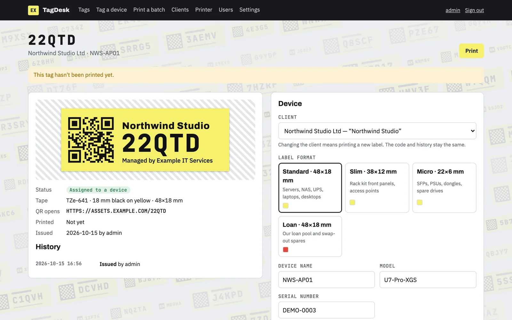 | 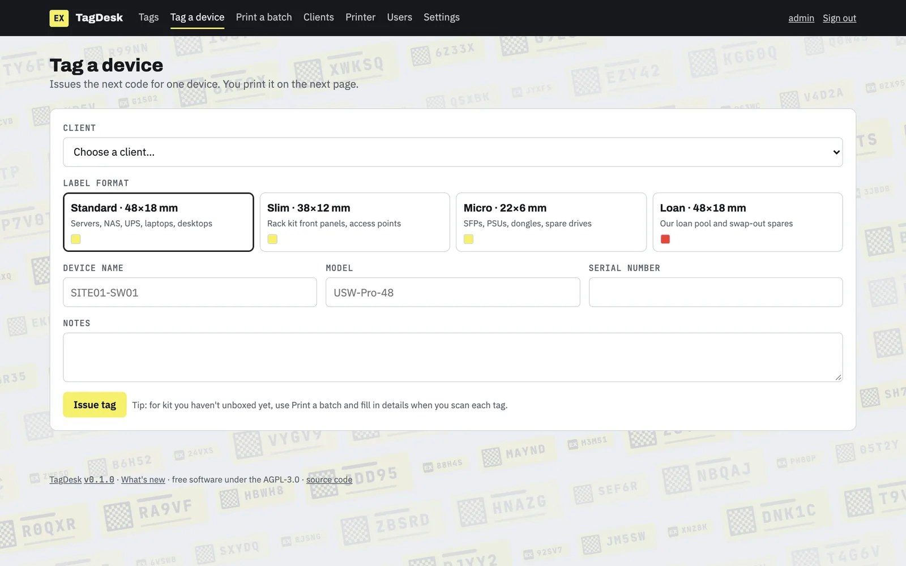 |
| 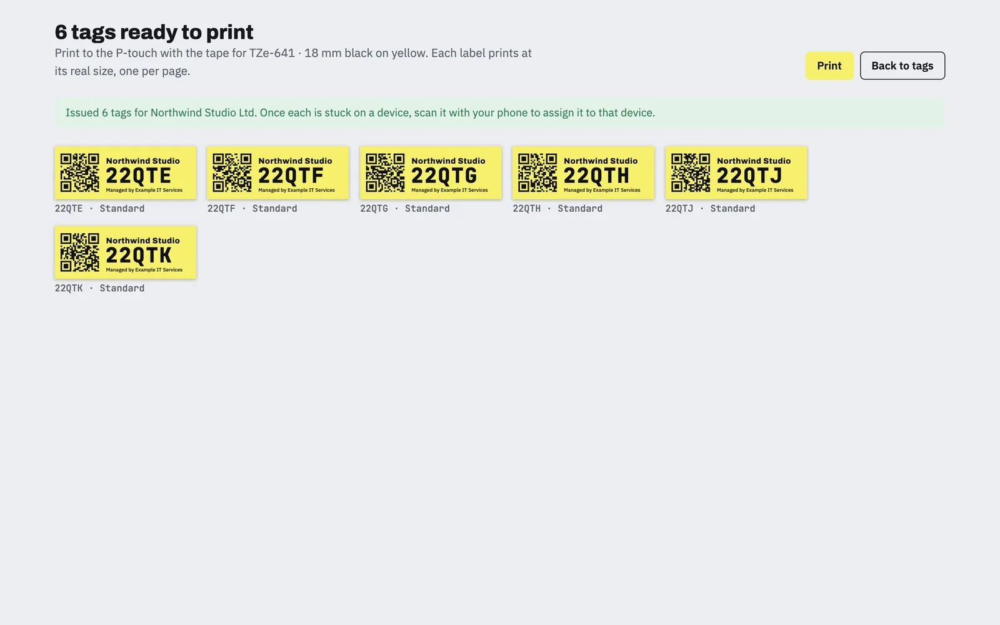 | 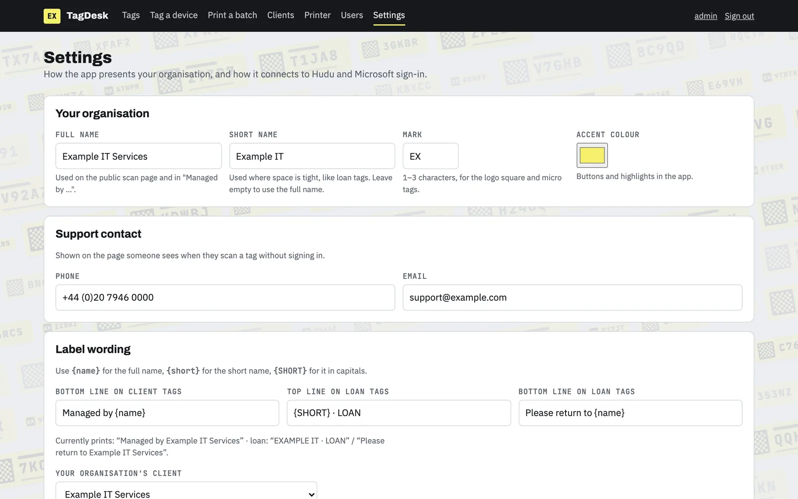 |
| 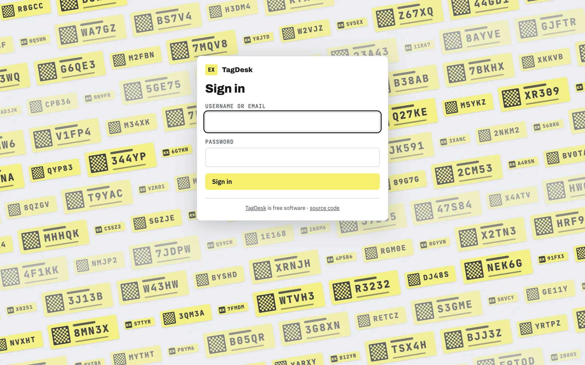 | |

## Requirements

- Docker with the Compose plugin.
- A reverse proxy with HTTPS in front of it (nginx, Caddy, Traefik, Nginx
  Proxy Manager…). People will scan tags from their phones, so the app usually
  needs to be reachable from the internet.
- Optional: a Brother **PT-P950NW** (Ethernet or Wi-Fi) or **PT-P900W**
  (Wi-Fi) label printer that the **TagDesk server** can reach over the
  network (see [Network access to the printer](#network-access-to-the-printer)).
  Only the PT-P950NW has been tested so far. Without one you can
  still print from the browser through the printer's normal driver.

## Quick start

```sh
git clone https://github.com/Fourth-Floor-Solutions/tagdesk.git
cd tagdesk
cp .env.example .env          # then edit it: see Configuration below
mkdir -p data && sudo chown 1000:1000 data
docker compose up -d --build
```

Open the app on `http://<server>:8080` (or through your reverse proxy), sign
in as `admin` with the `ADMIN_PASSWORD` from `.env`, and fill in the
**Set up** screen: your organisation's name, a short mark, colours and
support contact. Then change the admin password under your account.

Next steps in the app:

1. **Printer:** add your label printer's IP address and print a test label.
2. **Clients:** sync them from Hudu, or add them by hand. Keep each client's
   *label name* short; it's what gets printed.
3. **Tag a device** or **Print a batch**.

## Configuration

Two places:

**`.env`:** server settings and secrets.

| Variable | What it's for |
|---|---|
| `PUBLIC_BASE_URL` | The address people reach the app on, e.g. `https://assets.example.com`. **It's printed into every QR code, so set it before printing real tags and don't change it afterwards.** |
| `FORWARDED_ALLOW_IPS` | Your reverse proxy's IP address. Only this address may pass on the visitor's real IP, which the sign-in rate limit relies on. |
| `HOST_PORT` | Port the container is published on (default 8080). |
| `ADMIN_PASSWORD`, `ADMIN_EMAIL` | The first admin account, created on first start. |
| `TAGDESK_SECRET_KEY` | Optional. The key that encrypts secrets saved in Settings. If unset, one is created in `data/secret.key`. |
| `COOKIE_INSECURE=1` | Local development over plain http only. |

**Settings page (admins):** everything else:
- your organisation's name, short name, mark and accent colour
- support phone and email
- the wording on labels, your own client (used for loan tags), and the label formats and tapes you use
- the **Hudu** address and API key
- **Microsoft sign-in** (tenant ID, client ID, client secret and its expiry date) and which email domains get an account on first sign-in
- the source-code link

Changes take effect straight away, without a restart. Settings has **Test**
buttons for Hudu and Microsoft sign-in, and keeps a log of who changed what.

**Secrets** (the Hudu API key and the Microsoft client secret) are stored
encrypted, with the key kept outside the database (`data/secret.key`, or
`TAGDESK_SECRET_KEY`), and are never shown again after saving. A copy of the
database on its own doesn't reveal them. **Back up `data/secret.key` with the
database**; without it, saved secrets have to be entered again.

**Upgrading from an older version:** `HUDU_API_KEY`, `ENTRA_TENANT_ID`,
`ENTRA_CLIENT_ID`, `ENTRA_CLIENT_SECRET` and `SOURCE_URL` still work in
`.env`, and take priority over Settings (the fields show as set in `.env`).
To move a secret into the app, use **Copy into Settings**, then remove the
variable from `.env` and restart.

## Reverse proxy

Point your proxy at `http://<docker host>:<HOST_PORT>` and:

- terminate HTTPS (sign-in cookies are only sent over HTTPS when
  `PUBLIC_BASE_URL` starts with `https://`);
- send `X-Forwarded-For` and `X-Forwarded-Proto`, and set
  `FORWARDED_ALLOW_IPS` to the proxy's address;
- for Microsoft sign-in behind nginx, raise the proxy buffers, because the
  sign-in callback sends large headers:

```nginx
location / {
    proxy_pass http://127.0.0.1:8080;
    proxy_set_header Host $host;
    proxy_set_header X-Forwarded-For $proxy_add_x_forwarded_for;
    proxy_set_header X-Forwarded-Proto $scheme;
    proxy_buffer_size 16k;
    proxy_buffers 8 16k;
    proxy_busy_buffers_size 32k;
}
```

With Caddy, `reverse_proxy 127.0.0.1:8080` is enough.

Don't publish the container's port directly to the internet; only the proxy
should reach it.

## Label printers

> **Tested hardware:** so far this has only been tested with a **PT-P950NW**
> over Ethernet, using 12 mm and 18 mm laminated TZe tape. The PT-P900W uses
> the same commands and should work, but hasn't been tried, and neither have
> 6 mm tape or tape colours other than yellow. If you try one, please open an
> issue to say how it went.

Supported: Brother **PT-P950NW** and **PT-P900W** with laminated TZe tape.
Their siblings, the PT-P900 (USB only) and PT-P910BT (Bluetooth and USB),
use the same commands but have no network connection, so the app can't
reach them. Other Brother ranges (QL, TD, the smaller PT-P700 models) use
different commands and won't work.

### Network access to the printer

**The TagDesk server sends print jobs itself; the user's browser doesn't.**
When someone presses *Print label*, the server running TagDesk opens a
connection to the printer's IP address. So the printer must be reachable
**from the server**, not just from the person's computer:

- **Simplest:** run TagDesk on the same local network as the printer, for
  example on a small server or VM in the office.
- **TagDesk hosted elsewhere** (a data centre, the cloud, another site): it
  needs a route to the printer's network, such as a site-to-site VPN. Allow
  **TCP 9100** and **UDP 161** from the TagDesk server to the printer.
- **In Docker,** the container reaches the printer through the host's
  network, so a printer the host can reach is normally fine. Check from the
  host first: `nc -vz <printer-ip> 9100`.
- **No route to the printer?** Use *Print page* → *Print from browser*, which
  prints through the printer driver on the user's own computer. You lose the
  cassette check and tape tracking.

The Printer page shows *didn't answer a status request* when the server can't
reach a printer.

The app talks to the printer directly:

- **Printing:** raw raster data over **TCP 9100**.
- **Status:** **SNMP v2c**, community `public` (on by default on these
  printers). That's the loaded tape width and colour, errors, and the
  print-length counter used for tape tracking.

Add printers on the **Printer** page with a name and IP address. Give each one
a DHCP reservation so its address doesn't change. With more than one printer,
each label goes to the first printer (default first) that has the right tape
loaded, so you can keep different cassettes in different printers.

**Calibration:** if prints sit slightly high or low on the tape, adjust
*Vertical position* for that printer (14 dots ≈ 1 mm) and use *Save and print
a test*.

**Tape use:** the app reads the printer's lifetime print-length counter
around each job and charges the difference to the loaded cassette. Press
*New cassette fitted* when you change one, or set an estimate for one that was
already part-used. Every print job starts with about 25 mm of blank tape that
the printer cuts off, so batches use less tape than single labels.

**Formats:** four built-in layouts: Standard (48×18 mm), Slim (38×12 mm),
Micro (22×6 mm, code only) and Loan (48×18 mm). Under Settings → Label
formats you choose which are available, the tape colour for each (or *any
colour*) and the tape description people see. Sizes are fixed.

Brother's command reference for these printers is on Brother's developer site
("Raster Command Reference PT-P900/P900W/P950NW/P910BT"). It isn't included
here because its licence doesn't allow redistribution.

## Tag codes

Codes are five characters from the
[Crockford Base32](https://www.crockford.com/base32.html) alphabet, which
leaves out I, L, O and U so codes can't be misread. When someone types or
scans a code, O is read as 0 and I/L as 1. Codes are issued in sequence from a
random starting point, and a code never changes. If a device moves to another
client, print a new label with the new name and the same code.

The QR code holds `PUBLIC_BASE_URL/<code>` in upper case, which keeps the QR
code small enough to scan reliably on 12 mm tape.

## Hudu (optional)

1. In Hudu, create an API key with access to companies and assets.
2. In Settings → Hudu, enter your Hudu address and the API key, save, and
   press **Test Hudu connection**.
3. On the Clients page, **Sync from Hudu** to import your companies.

When tagging a device you can then search that client's Hudu assets by name or
serial number and link the tag to one.

**Writing the code into Hudu:** turn on *Write each tag's code into the
linked Hudu asset* in Settings. The asset layouts need a text field for it
(default name *Asset Tag*). This script adds one, dry run first:

```sh
docker exec tagdesk python -m scripts.add_asset_tag_field <layout id> [<layout id> …]
docker exec tagdesk python -m scripts.add_asset_tag_field <layout id> … --apply
```

It backs each layout up to `data/hudu-backups/` first and checks that every
existing field survives.

How the app keeps Hudu up to date:
- **Linking a tag** writes the code into the asset.
- **Relinking or retiring a tag** clears the code from the old asset, but only
  if it still holds that code.
- **Every write** re-sends the asset's other fields unchanged, reads the asset
  back, and puts the originals back if anything else changed.

Calls are spaced out, because Hudu briefly blocks bursts of requests.

## Microsoft sign-in (optional)

Register an app in Microsoft Entra ID:

- **Supported account types:** this organisation only.
- **Redirect URI (Web):** `<PUBLIC_BASE_URL>/auth/callback`
- **Authentication:** ID tokens on.
- **Client secret:** create one and note when it expires.

With the Azure CLI:

```sh
APP=$(az ad app create --display-name "TagDesk" --sign-in-audience AzureADMyOrg \
  --web-redirect-uris "https://assets.example.com/auth/callback" \
  --enable-id-token-issuance true --query appId -o tsv)
az ad sp create --id "$APP"
az ad app credential reset --id "$APP" --years 2 --query password -o tsv   # the client secret
```

Enter the tenant ID, the app's client ID, the secret and its expiry date in
Settings → Microsoft sign-in, and save. The sign-in page then shows only
**Sign in with Microsoft**; no restart is needed. Admins are warned 30 days
before the secret expires. The local login stays
available behind *Use a local account*, so an admin can still get in if
Microsoft sign-in breaks.

People are matched to accounts by email. Anyone else is turned away unless
their email domain is listed under Settings → Microsoft sign-in, in which case
they get a *user* account on first sign-in.

## Users and roles

- **Admin:** everything, plus Settings, Users, clients and printers.
- **User:** tag devices, edit tags, print.

Each person can set their display name under their account; it's what tag
history shows.

## What the public sees

Without signing in, a scan shows:
- the tag code
- the device name
- the client's label name ("This equipment belongs to …")
- your organisation's name and support contact

Serial numbers, notes, Hudu links and history are only shown to signed-in
staff. Codes are sequential, so anyone could try codes one after another; keep
anything you wouldn't print on the label itself out of the device name.

## Security

- Report vulnerabilities privately; see [SECURITY.md](SECURITY.md).
- **Sign-in:** passwords are hashed (PBKDF2), failed sign-ins are limited per
  IP, and Microsoft sign-in only accepts accounts from your own tenant.
- **Sessions:** signed, HTTP-only cookies, HTTPS-only when `PUBLIC_BASE_URL`
  is https, and SameSite=Lax. Cross-site form posts are refused, and signing
  out is a form post.
- **Headers:** a Content-Security-Policy, no framing, `nosniff` and a
  same-origin referrer policy. Add HSTS at your reverse proxy.
- **Secrets** saved in Settings are encrypted, with the key outside the
  database; see [Configuration](#configuration).
- **Public scan page:** codes are short and issued in sequence so they're easy
  to read, which means they're also easy to guess. Anyone can look up a code
  and see the owner's name, the device name and your support contact, so put
  nothing in the device name you wouldn't print on the label. Lookups are
  limited per IP.
- **Admins** are trusted: they can point the app at any Hudu server or printer
  address. Give the admin role only to people who need it.
- **The container** runs as a non-root user with a read-only filesystem and
  no extra capabilities. Only your reverse proxy should be able to reach its
  port.

## Data and backups

Everything is in one SQLite file, `data/tagdesk.db`: tags, clients, users,
printers, settings and history. Saved secrets are encrypted with
`data/secret.key` (or `TAGDESK_SECRET_KEY`), which isn't in the database.

- **Download a backup:** Settings → **Backup** → **Download backup** gives a
  consistent copy, safe while TagDesk is running. **Download secret.key**
  gives the key (keep it separately and safely).
- **Daily copies:** TagDesk keeps one copy a day in `data/backups/`, the
  newest 7 by default. Set `BACKUP_KEEP` to change how many, or `0` to turn
  them off.
- **Restore:** stop TagDesk (`docker compose down`), copy the backup to
  `data/tagdesk.db` and the key to `data/secret.key` (delete any
  `tagdesk.db-wal` and `tagdesk.db-shm` files there), then
  `docker compose up -d`.

Backing up the whole `data/` directory also works.

To update, pull the new code and run `docker compose up -d --build`. The
database is upgraded automatically on start. To show the exact build in the
footer, pass the commit when building:

```sh
GIT_COMMIT=$(git rev-parse --short HEAD) docker compose up -d --build
```

The running version is also at `/version`. Changes are listed in
[CHANGELOG.md](CHANGELOG.md) and on the app's **What's new** page.

## Development

See [CONTRIBUTING.md](CONTRIBUTING.md) for setting up, running the checks
and proposing changes, and [docs/ARCHITECTURE.md](docs/ARCHITECTURE.md) for
how TagDesk works inside.

## Licence

TagDesk is free software, licensed under the
[GNU Affero General Public License v3.0](LICENSE). Copyright © 2026 Fourth
Floor Solutions Ltd.

If you run a modified version for other people to use over a network, the
AGPL requires you to offer them its source code. The footer links to
`SOURCE_URL`; point it at your copy.

The bundled fonts (Archivo, JetBrains Mono, IBM Plex Sans) are under the SIL
Open Font License; their licences are in `app/fonts/`.

Brother, P-touch and TZe are trademarks of Brother Industries; Hudu and
Microsoft Entra are trademarks of their owners. This project isn't affiliated
with or endorsed by any of them.
